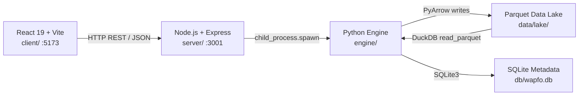

# WAPFO — Workload-Aware Partitioning and File Optimization

> A reproducible, end-to-end data engineering system demonstrating time-partitioned Parquet data lakes, partition pruning, small-file compaction, DuckDB analytical benchmarking, reconciliation auditing, and a React dashboard — built as a vertical slice from raw CSV to queryable lake.


---

## 1. Problem Statement

Analytical data lakes accumulate small Parquet files as ingestion pipelines write one file per micro-batch or per day. Over time this creates three compounding problems:

1. **Query fan-out**: a full-table scan must open every file, paying per-file metadata overhead at scale.
2. **Missed pruning**: without a time partition hierarchy, the query engine cannot skip irrelevant data even when filters are present.
3. **Storage amplification**: many redundant row-group footers inflate storage for small datasets.

WAPFO addresses all three by comparing unpartitioned, monthly, and daily partition layouts, measuring the pruning ratio each provides, compacting small files within each partition, and re-benchmarking after compaction to surface the real improvement.

---

## 2. Key Features

- **Three partition layouts** — unpartitioned flat files, `event_month=YYYY-MM/`, and `event_date=YYYY-MM-DD/`
- **Deterministic data generation** — reproducible with a fixed NumPy seed; 1,000 clean rows + 9 injected defects by default
- **Multi-rule validation** — six distinct rejection categories with per-row quarantine records
- **Conflict-aware deduplication** — exact duplicates dropped; `event_id` collisions resolved and quarantined
- **Atomic lake writes** — PyArrow writes to `.tmp` then `os.replace()`, preventing partial files
- **DuckDB benchmarking** — 5-repetition median timing with warm-cache separation; partition-directory pruning estimates
- **Small-file compaction** — merges all per-run Parquet files in each partition directory into one, then re-benchmarks
- **Full reconciliation audit** — `total_input = accepted_unique + exact_duplicates + rejected` verified on every run
- **Idempotent reruns** — rerunning the same input produces identical lake outputs and reconciliation checks
- **SQLite provenance store** — every run, benchmark result, rejected row, and file fingerprint (SHA-256) is recorded
- **Node.js REST API** — Express server bridges the React frontend to the Python engine via `child_process.spawn`
- **React 19 dashboard** — bronze-themed, responsive UI with KPI cards, live charts, and expandable detail panels

---

## 3. Architecture



The three layers share no in-process memory. The frontend reads only from the Express API. The API invokes Python scripts as subprocesses with explicit argument arrays (no shell interpolation). The engine reads and writes only the `data/` and `db/` directories.

---

## 4. Technology Stack

| Layer | Technology | Version |
|---|---|---|
| **Python Engine** | Python | 3.14 |
| **Columnar Engine** | DuckDB | 2.0.0 |
| **Storage Format** | Apache Parquet via PyArrow | 24.0.0 |
| **Data Manipulation** | Pandas | 2.3.3 |
| **Numerical Ops** | NumPy | 2.4.4 |
| **Test Data** | Faker | 40.54.0 |
| **Testing** | Pytest | 9.1.1 |
| **API Server** | Node.js + Express | v24 / 5.x |
| **File Upload** | Multer | 2.x |
| **Frontend** | React | 19 |
| **Build Tool** | Vite | 6.x |
| **Charts** | Recharts | 3.x |
| **HTTP Client** | Axios | 1.x |
| **Audit Store** | SQLite 3 | (stdlib) |

---

## 5. Screenshots

> Screenshots are taken from a live run of the dashboard after executing the full pipeline and benchmark workflow.

| Overview Dashboard | Partition Comparison |
|---|---|
| _(run the app to see the live dashboard)_ | _(run the app to see charts)_ |

---

## 6. Repository Structure

```
wpto/
├── client/                   # React 19 + Vite frontend (standalone service)
│   ├── src/
│   │   ├── api/client.js     # Axios base client (reads VITE_API_URL)
│   │   ├── pages/
│   │   │   ├── Dashboard.jsx # KPI cards, benchmark chart, compaction summary
│   │   │   ├── Execute.jsx   # Generate → pipeline → benchmark workflow
│   │   │   ├── Comparison.jsx# Partition strategy comparison with charts
│   │   │   └── History.jsx   # Audit ledger with run detail panel
│   │   ├── theme.js          # Bronze palette + chart color constants
│   │   └── App.jsx           # Sidebar layout and routing
│   ├── .env.example          # VITE_API_URL=http://localhost:3001
│   ├── package.json
│   └── README.md             # Frontend-specific setup guide
│
├── server/                   # Node.js Express backend (standalone service)
│   ├── index.js              # REST endpoints (upload, generate, pipeline, benchmark, compact, runs, health)
│   ├── python_runner.js      # child_process.spawn wrapper with timeout
│   ├── .env.example          # PORT=3001, PYTHON_BIN=python
│   ├── package.json
│   └── README.md             # Backend-specific API reference
│
├── engine/                   # Python analytics engine
│   ├── generator.py          # Deterministic synthetic data generator with injected defects
│   ├── pipeline.py           # CSV ingestion, validation, dedup, enrichment, lake write, reconciliation
│   ├── validation.py         # Schema check, per-row validation rules, resolve_duplicates
│   ├── benchmark.py          # DuckDB timing harness (5 repetitions, warm-cache median)
│   ├── compaction.py         # Partition-level file merger, file health reporter
│   ├── db.py                 # SQLite schema init and all insert/query helpers
│   ├── db_query.py           # CLI wrapper to expose SQLite data to the Node API
│   └── tests/
│       ├── conftest.py       # Shared tmp-dir fixtures
│       └── test_pipeline.py  # 29 unit and integration tests
│
├── data/
│   ├── raw/                  # Uploaded or generated CSVs
│   ├── lake/
│   │   ├── unpartitioned/    # Single flat Parquet files per run
│   │   ├── monthly/          # event_month=YYYY-MM/ partitions
│   │   └── daily/            # event_date=YYYY-MM-DD/ partitions
│   ├── quarantine/           # Rejected rows as CSV, one file per run
│   └── users.csv             # Reference user pool (U0001–U0200)
│
├── db/
│   └── wapfo.db              # SQLite audit and provenance store
│
├── requirements.txt          # Python dependencies
└── README.md                 # This file
```

---

## 7. Prerequisites

| Requirement | Minimum version | Notes |
|---|---|---|
| Python | 3.11+ | Tested on 3.14.6 |
| pip | (bundled with Python) | |
| Node.js | 18+ | Tested on v24.18.0 |
| npm | (bundled with Node.js) | |
| Git | any | |

No Docker required. No cloud credentials required. Everything runs locally.

---

## 8. Installation

```bash
# 1. Clone the repository
git clone https://github.com/Sanjay6968/hack.git
cd hack

# 2. Install Python dependencies
pip install -r requirements.txt

# 3. Install backend dependencies
cd server
npm install
cd ..

# 4. Install frontend dependencies
cd client
npm install
cd ..
```

**Optional — copy environment files before first run:**

```bash
cp client/.env.example client/.env
cp server/.env.example server/.env
```

The defaults (`VITE_API_URL=http://localhost:3001` and `PORT=3001`) work out of the box.

---

## 9. Quick Start

Open **three terminals** in the project root:

```bash
# Terminal 1 — Run all 29 tests (optional but recommended first)
python -m pytest engine/tests/ -v

# Terminal 2 — Start the Node.js API server
cd server
node index.js
# → WAPFO server running on http://localhost:3001

# Terminal 3 — Start the React frontend
cd client
npm run dev
# → Open http://localhost:5173
```

Navigate to `http://localhost:5173` and use the **Execute Pipeline** page to generate data and run the full workflow.

---

## 10. Data Generation and Ingestion Workflow

### A. Generate synthetic data via the dashboard

Use the **Execute Pipeline** page → "Generate Dataset" → set rows and seed → click Generate.

### B. Generate from the command line

```bash
# Quick starter sample: 1,009 rows (1,000 clean + 9 injected defects)
python -m engine.generator --rows 1000 --seed 42 --out data/raw/sample_1000.csv

# Large volume run: 100,009 rows
python -m engine.generator --rows 100000 --seed 42 --out data/raw/large_100k.csv
```

The `--seed` flag guarantees byte-identical output across machines and runs (reproducibility).

### C. Ingest a CSV through the pipeline

```bash
python -m engine.pipeline --csv data/raw/sample_1000.csv --run-id run-demo-01
```

The pipeline:
1. **Loads** the CSV with dtype=str (no coercion on read).
2. **Checks schema** — raises `ValueError` if any required column is missing.
3. **Validates rows** — rejects on six rules; accepted rows continue.
4. **Resolves duplicates** — drops exact duplicates; retains lowest-amount record for `event_id` conflicts; quarantines the rest (see [§12. Duplicate Policy](#12-data-validation-and-quarantine)).
5. **Enriches** — parses timestamps, derives `event_date`, `event_month`, adds `run_id` and `ingested_at`.
6. **Writes lake** — atomic PyArrow writes to all three partition layouts simultaneously.
7. **Records reconciliation** — asserts `total_input = accepted_unique + exact_duplicates + rejected`.

The result JSON includes a `reconciliation.check: true/false` field.

---

## 11. Partitioning Strategies

WAPFO writes every accepted row simultaneously into three layout strategies:

| Layout | Partition Column | Example Path |
|---|---|---|
| **Unpartitioned** | _(none)_ | `data/lake/unpartitioned/<run_id>.parquet` |
| **Monthly** | `event_month` | `data/lake/monthly/event_month=2024-06/<run_id>.parquet` |
| **Daily** | `event_date` | `data/lake/daily/event_date=2024-06-15/<run_id>.parquet` |

DuckDB uses `hive_partitioning=true` on monthly and daily layouts so the query planner can exploit directory-level partition metadata when evaluating `WHERE` clauses.

### Trade-off summary

| Layout | Pruning granularity | File count (1,009 rows, post-compaction) | Avg file size | Optimal workload |
|---|---|---|---|---|
| Unpartitioned | None — 100% scan always | 2 | ~95 KB | Low-volume or ad-hoc full scans |
| Monthly | Medium — 92.3% pruned on monthly query | 26 | ~13 KB | 100 K–10 M rows/month |
| Daily | Fine — 99.7% pruned on daily query | 359 | ~7 KB | >1 M rows/day |

> **Small-file note**: at 1,009 rows all three layouts produce sub-megabyte files, which is a known dataset-size artefact. See [§19. Limitations](#19-limitations).

---

## 12. Data Validation and Quarantine

The validation layer applies six ordered rules to every row. Any failure immediately quarantines the row; a row can carry multiple rejection reasons separated by `|`.

| Rule | Reject reason | Description |
|---|---|---|
| Null primary key | `null_event_id` | `event_id` is null or empty string |
| Invalid event type | `invalid_event_type` | `event_type` not in `{page_view, add_to_cart, purchase, search, logout}` |
| Null user | `null_user_id` | `user_id` is null or empty string |
| Invalid user reference | `invalid_user_id` | `user_id` not in `data/users.csv` reference pool (U0001–U0200) |
| Non-finite amount | `non_finite_amount` | `amount` is `inf` or `nan` |
| Negative purchase amount | `negative_purchase_amount` | `event_type == purchase` and `amount < 0` |

Quarantined rows are stored both in SQLite (`rejected_rows` table) and as a per-run CSV under `data/quarantine/<run_id>_quarantine.csv`.

### Duplicate policy

The pipeline applies a two-stage deduplication strategy:

1. **Exact duplicates** — identical rows (all columns equal) are silently dropped. These carry zero information and their removal is unambiguous.
2. **Conflicting duplicates** — rows sharing the same `event_id` but differing in one or more other fields represent a data integrity problem. The engine retains the record with the **lowest `amount`** value and quarantines the rest.

> **Important caveat**: "lowest amount" is a conservative tie-breaking rule, not a business-validated resolution strategy. It assumes that an erroneous re-transmission tends to inflate the amount field (e.g. a retry with updated pricing). This assumption may not hold for all datasets. The rule is documented here explicitly; production systems should substitute a domain-specific resolution policy (e.g. latest timestamp wins, or manual review queue).

---

## 13. Benchmark Methodology

### Setup

```bash
# Run a full pipeline first to populate the lake
python -m engine.pipeline --csv data/raw/sample_1000.csv --run-id bench-pre

# Run pre-compaction benchmarks
python -m engine.benchmark --run-id bench-pre --compaction-status pre-compaction

# Compact all strategies
python -m engine.compaction --strategy all --run-id bench-post

# Run post-compaction benchmarks
python -m engine.benchmark --run-id bench-post --compaction-status post-compaction
```

### Timing methodology

- Each query runs **5 repetitions** against each of the three partition layouts.
- **`median_ms`** is the median of all 5 runs.
- **`warm_median_ms`** excludes run 1 (cold OS page cache) and takes the median of runs 2–5.
- The benchmark report notes that "timings include cold first run; warm_median_ms excludes run 1."
- Pruning ratios are directory-level estimates based on partition-folder matching, not DuckDB internal file counters.

### Benchmark results (1,009-row sample dataset)

#### Pre-compaction vs. post-compaction latency (median over 5 runs)

| Query | Pre-compaction (ms) | Post-compaction (ms) | Improvement |
|---|---|---|---|
| `full_scan` | 1,112.79 | 518.00 | +53.4% faster (2.1×) |
| `monthly_filter` | 1,064.11 | 541.92 | +49.1% faster (2.0×) |
| `daily_filter` | 809.10 | 430.61 | +46.8% faster (1.9×) |

#### Pruning estimates (daily layout, post-compaction)

| Query | Files scanned (estimated) | Total files | Estimated pruning ratio |
|---|---|---|---|
| `full_scan` | 359 / 359 | 359 | 0% |
| `monthly_filter` | 28 / 359 | 359 | 92.2% |
| `daily_filter` | 1 / 359 | 359 | 99.7% |

> **Precision note**: The 99.7% daily pruning figure (1 of 359 files) is a directory-level estimate — the benchmark counts how many partition directories match the `WHERE` predicate, not how many files DuckDB actually opened internally. DuckDB may still read row-group footers from files within the matched partition. These numbers are therefore upper bounds on effective pruning, not direct measurements of DuckDB I/O.

#### Analytical result parity (all layouts, all queries)

All three layouts produce identical analytical outputs before and after compaction:

| Query | Result checksum |
|---|---|
| `full_scan` | `rows=5, sum=1,475,319.10` |
| `monthly_filter` | `rows=5, sum=90,867.45` |
| `daily_filter` | `rows=4, sum=0.00` |

---

## 14. Compaction Methodology

### How compaction works

For each partition directory:

1. Read all `.parquet` files in the directory into Pandas DataFrames.
2. Concatenate them into a single DataFrame.
3. Write to `<run_id>_compacted.parquet` via a `.tmp` → `os.replace()` atomic swap.
4. Delete all source files that are not the output file.

This reduces the per-partition file count from N (one file per pipeline run) to 1, eliminating per-file open overhead for subsequent queries.

### Compaction results (daily layout, 1,009-row sample)

| Metric | Pre-compaction | Post-compaction | Change |
|---|---|---|---|
| File count | 702 | 359 | −48.9% |
| Storage | 4.68 MB | 2.51 MB | −46.4% |

> The pre-compaction file count of 702 reflects multiple pipeline runs before compaction was applied. Each `engine.pipeline` invocation writes one Parquet file per partition directory (one per day for the daily layout), so 702 = number of unique dates × number of runs before compaction.

---

## 15. Reconciliation and Idempotency

Every pipeline run produces a `reconciliation` block:

```json
{
  "total_input": 1009,
  "accepted_unique": 1003,
  "exact_duplicates": 1,
  "rejected": 5,
  "check": true
}
```

The `check` field is `true` when:

```
total_input == accepted_unique + exact_duplicates + rejected
```

This equation accounts for every input row with no double-counting. If `check` is `false`, the pipeline has a bug and must not be trusted.

**Idempotency**: rerunning the same CSV with the same `--run-id` produces the same lake output because:

- PyArrow overwrites the same file path atomically.
- Exact duplicates from the previous run are dropped.
- SQLite records are keyed by `run_id`; duplicate inserts are `INSERT OR REPLACE`.

---

## 16. Automated Test Suite

29 unit and integration tests in [`engine/tests/test_pipeline.py`](engine/tests/test_pipeline.py), all passing:

```bash
python -m pytest engine/tests/ -v
# 29 passed
```

| # | Test | Category |
|---|---|---|
| 1 | `test_reproducible` | Generator |
| 2 | `test_different_seed_differs` | Generator |
| 3 | `test_total_rows` | Generator |
| 4 | `test_has_null_event_id` | Generator defects |
| 5 | `test_has_invalid_event_type` | Generator defects |
| 6 | `test_has_late_arriving_event` | Generator defects |
| 7 | `test_happy_path` | Pipeline E2E |
| 8 | `test_empty_input` | Edge case — empty batch |
| 9 | `test_missing_column_fails` | Edge case — schema |
| 10 | `test_malformed_csv_fails_gracefully` | Edge case — corrupt file |
| 11 | `test_schema_drift_ignored` | Edge case — schema drift |
| 12 | `test_all_null_event_ids_rejected` | Validation |
| 13 | `test_exact_duplicates_dropped` | Deduplication |
| 14 | `test_conflicting_duplicate_keeps_lowest_amount` | Deduplication |
| 15 | `test_invalid_event_type_rejected` | Validation |
| 16 | `test_invalid_user_id_rejected` | Validation — referential integrity |
| 17 | `test_negative_purchase_amount_rejected` | Validation |
| 18 | `test_timezone_boundary_accepted` | Validation |
| 19 | `test_late_arriving_event_accepted_in_own_partition` | Partitioning |
| 20 | `test_idempotent_rerun` | Idempotency |
| 21 | `test_parquet_files_written_all_strategies` | Lake write |
| 22 | `test_partial_failure_status_recorded` | Error handling |
| 23 | `test_null_user_id_rejected` | Validation |
| 24 | `test_non_finite_amount_rejected` | Validation |
| 25 | `test_conflicting_duplicate_multiple_records` | Deduplication |
| 26 | `test_exact_duplicates_within_conflict_group` | Deduplication |
| 27 | `test_rerun_same_run_id` | Idempotency |
| 28 | `test_analytical_parity_duckdb` | Correctness — DuckDB parity |
| 29 | `test_configurable_large_volume_run` | Volume — 100 K rows |

### Volume and coverage

The default sample (1,000 clean rows + 9 injected defects) exercises every validation path and all partition strategies in under 2 seconds. The large-volume test (`test_configurable_large_volume_run`) runs a 100,009-row end-to-end pipeline in approximately 8–10 seconds to verify scalability of the generation and ingestion paths.

**Injected defect types (9 rows in every default run, seed 42):**

| Defect | Count |
|---|---|
| Exact duplicate of row 0 | 1 |
| Conflicting duplicate of row 1 (amount+50) | 1 |
| Null `event_id` | 1 |
| Invalid `event_type` (`"UNKNOWN"`) | 1 |
| Invalid `user_id` (`"U9999"`) | 1 |
| Negative `amount` on purchase | 1 |
| Late-arriving event (timestamp ~18 months prior) | 1 |
| Non-finite `amount` (`inf`) | 1 |
| Null `user_id` | 1 |

---

## 17. Engineering Decisions and Trade-offs

### Why Parquet + Hive partitioning?

Parquet's columnar layout enables predicate pushdown at the row-group level. Hive-style directory naming (`event_date=YYYY-MM-DD`) allows query engines like DuckDB to skip entire directories before opening any file, compounding the per-file savings with directory-level elimination.

### Why DuckDB for benchmarking?

DuckDB runs entirely in-process, requiring no server setup and producing deterministic results on the same machine. It supports `read_parquet` with `hive_partitioning=true`, making it appropriate for validating partition pruning behaviour on local Parquet lakes.

### Why SQLite for provenance?

SQLite is zero-dependency, file-local, and acid-compliant. Every run, benchmark result, file fingerprint (SHA-256), and rejected row is recorded durably without requiring a separate database service. This makes the system self-contained and portable.

### Why Node.js as the API layer?

The Python engine uses blocking I/O and can run for 30–180 seconds during benchmark and compaction operations. Wrapping it in a Node.js Express server allows the frontend to issue non-blocking requests with configurable timeouts, without blocking the event loop for other requests. `child_process.spawn` with strict argument arrays avoids shell injection risk.

### Why atomic writes (`os.replace`)?

PyArrow writes to `<target>.tmp` first, then `os.replace()` swaps the file atomically on POSIX and Windows. This prevents the query engine from ever observing a partially written Parquet file.

### Duplicate resolution policy

The lowest-amount rule for `event_id` conflicts is a conservative fallback. It is not a universally correct policy. See [§12. Duplicate Policy](#12-data-validation-and-quarantine) for the full caveat.

---

## 18. Limitations

1. **Dataset size**: The benchmark dataset contains 1,009 rows and produces sub-megabyte files in all three partition layouts. The measured latency improvements and file-count reductions are valid experimental results for this dataset, but they cannot be extrapolated to production-scale workloads where file sizes would be in the hundreds of megabytes to gigabytes range.

2. **Pruning measurement**: Pruning ratios are directory-level estimates, not direct measurements of DuckDB I/O. DuckDB may still read row-group footers from files in matched partition directories. The numbers are upper bounds on effective pruning.

3. **Single-machine benchmarks**: All timings are from a single machine, single-threaded DuckDB process. Results will vary with hardware, available memory, and OS page cache state.

4. **Cold vs. warm cache**: The benchmark explicitly notes the warm-cache (`warm_median_ms`) versus cold (`first_run_ms`) distinction. Warm-cache figures reflect repeated analytical queries, not cold-start latency.

5. **No distributed execution**: WAPFO is a local vertical slice, not a distributed system. It demonstrates concepts that apply to Spark, Trino, or BigQuery, but does not implement them at scale.

6. **Duplicate policy**: The lowest-amount conflict resolution is a placeholder heuristic, not a validated business rule.

---

## 19. Future Improvements

- **Z-ordering / data skipping**: Sort Parquet row groups by high-cardinality columns (`user_id`, `event_type`) to enable fine-grained predicate pushdown within files.
- **Iceberg / Delta Lake integration**: Replace the custom SQLite provenance store with an open table format that provides ACID transactions, schema evolution, and time travel natively.
- **Streaming ingestion**: Replace batch CSV ingestion with an Apache Kafka consumer writing micro-batches to the lake.
- **Configurable duplicate policy**: Expose the conflict resolution strategy as a pipeline parameter (e.g., `--conflict-resolution latest_timestamp|lowest_amount|reject_all`).
- **Production-scale benchmarks**: Re-run the benchmark suite on a dataset with ≥10 M rows per month to reach file sizes where partition pruning and compaction produce measurable I/O savings.
- **Column-level statistics**: Collect DuckDB `PRAGMA storage_info` to report actual row-group statistics and validate claimed pruning against measured I/O.
- **CI/CD pipeline**: Add a GitHub Actions workflow that runs `pytest engine/tests/` and `npm run build --prefix client` on every push.

---

## 20. API Reference

The Node.js Express server exposes the following endpoints on `http://localhost:3001`:

| Method | Path | Description |
|---|---|---|
| `GET` | `/api/health` | Server liveness check |
| `POST` | `/api/generate` | Generate synthetic CSV (`rows`, `seed`) |
| `POST` | `/api/upload` | Upload a CSV file (multipart/form-data) |
| `POST` | `/api/pipeline` | Run ingestion pipeline (`filename`, `run_id`) |
| `POST` | `/api/benchmark` | Run DuckDB benchmarks (`run_id`, `compaction_status`) |
| `POST` | `/api/compact` | Compact partition files (`strategy`, `run_id`) |
| `GET` | `/api/runs` | List all pipeline runs from SQLite |
| `GET` | `/api/runs/:id` | Get detail for a single run |
| `GET` | `/api/benchmarks` | List all benchmark records from SQLite |
| `POST` | `/api/benchmarks/clear` | Truncate benchmark table |
| `GET` | `/api/data-quality` | Quarantine and rejection summary (optional `?run_id=`) |
| `GET` | `/api/file-health` | File count and size metrics for all three layouts |
