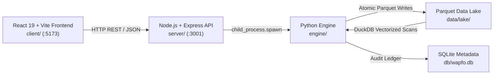

# WAPFO - Workload-Aware Partitioning and File Optimization

A reproducible data engineering system demonstrating time-partitioned Parquet data lakes, partition pruning, small-file compaction, DuckDB analytical benchmarking, reconciliation auditing, and a React dashboard built as a vertical slice from raw CSV ingestion to queryable lake.

---

## 1. Problem Statement

Analytical data lakes often ingest records on micro-batch schedules, producing numerous small Parquet files. This introduces three performance bottlenecks:

1. **Query Fan-out**: Scans must open many small files, incurring repeated file-open and footer-read overhead.
2. **Missing Partition Pruning**: Without time-hierarchy directory layouts, query engines must scan unrelated temporal ranges.
3. **Storage Overhead**: Redundant Parquet metadata and compression dictionary footers inflate physical storage for small row counts.

WAPFO evaluates these trade-offs by writing data across unpartitioned, monthly, and daily partition layouts, measuring DuckDB partition pruning efficacy, compacting files within partitions, and verifying data reconciliation across every stage.

---

## 2. Architecture



The layers operate across isolated runtime boundaries:
- **Frontend (`client/`)**: Standalone React 19 application using Axios and Recharts. Communicates strictly via HTTP.
- **Backend (`server/`)**: Express REST API executing engine tasks via subprocess calls with explicit argument arrays.
- **Engine (`engine/`)**: Python modules handling validation, deduplication, Parquet lake operations, DuckDB benchmarking, and SQLite logging.

---

## 3. Quick Start

### Prerequisites
- Python 3.11+ (tested on Python 3.14.6)
- Node.js 18+ (tested on Node.js v24.18.0)
- npm (bundled with Node.js)
- Git

### Installation

Clone the repository and install dependencies for all layers:

```bash
# 1. Clone repository
git clone https://github.com/Sanjay6968/hack.git
cd hack

# 2. Install Python dependencies
pip install -r requirements.txt

# 3. Install backend dependencies
cd server
npm install
cd ..

# 4. Install frontend dependencies
cd client
npm install
cd ..
```

### Running the Services

Start the backend and frontend in separate terminals:

```bash
# Terminal 1: Backend API (:3001)
cd server
node index.js

# Terminal 2: Frontend Client (:5173)
cd client
npm run dev
```

Open `http://localhost:5173` in your browser.

To run the automated verification test suite:

```bash
# Terminal 3: Test suite (29 tests)
python -m pytest engine/tests/ -v
```

---

## 4. One-Million-Record Validation

WAPFO was evaluated on a 1,000,000-row synthetic run to measure ingestion throughput, reconciliation consistency, and physical file layout characteristics at scale.

```bash
# Generate 1M-record synthetic batch
python -m engine.generator --rows 1000000 --seed 42 --out data/raw/large_1m.csv

# Ingest through the pipeline with timing measurement
Measure-Command {
    python -m engine.pipeline --csv data/raw/large_1m.csv --run-id run-large-1m
}
```

### Execution and Reconciliation Results

| Metric | Measured Value |
|---|---|
| **Generated observations** | 1,000,009 |
| **Accepted records** | 1,000,003 |
| **Exact duplicates dropped** | 1 |
| **Rejected / Quarantined records** | 5 |
| **Pipeline execution duration** | 127.82 seconds (~2.13 minutes) |
| **Reconciliation invariant** | Total Input (1,000,009) = Accepted (1,000,003) + Duplicates (1) + Rejected (5) |
| **Reconciliation status** | True (`check: true`) |

### Storage Footprint by Layout

| Layout | Partition Count | Physical Size | File Count |
|---|---|---|---|
| **Unpartitioned** | 1 root | 59.7 MB | 1 file |
| **Monthly** | 13 partitions | Approximately 59 MB | 13 files (~4.8 MB / file) |
| **Daily** | 366 partitions | 57.9 MB | 366 files (~158 KB / file) |

---

## 5. Partitioning Strategies and Lake Structure

The engine writes incoming valid batches simultaneously into three target layouts under `data/lake/`:

```
data/lake/
├── unpartitioned/
│   └── <run_id>.parquet
├── monthly/
│   ├── event_month=2024-01/
│   │   └── <run_id>.parquet
│   └── ...
└── daily/
    ├── event_date=2024-01-01/
    │   └── <run_id>.parquet
    └── ...
```

### Strategy Comparison

| Strategy | Partition Key | Pruning Mechanism | Optimal Workload Fit |
|---|---|---|---|
| **Unpartitioned** | None | Full file scan | Batch reporting across all dates |
| **Monthly** | `event_month=YYYY-MM` | Directory skipping via Hive partition filter | Medium-granularity date filtering |
| **Daily** | `event_date=YYYY-MM-DD` | Directory skipping via Hive partition filter | High-volume operational point lookups |

---

## 6. Data Validation and Quarantine

Every record undergoes strict multi-rule schema and semantic validation prior to lake publication:

| Defect Rule | Rejection Tag | Action |
|---|---|---|
| Null Primary Key | `null_event_id` | Quarantined to CSV and SQLite `rejected_rows` |
| Invalid Event Type | `invalid_event_type` | Must belong to `{page_view, add_to_cart, purchase, search, logout}` |
| Null User ID | `null_user_id` | Quarantined |
| Foreign Key Integrity | `invalid_user_id` | User must exist in reference pool (`data/users.csv`) |
| Non-finite Amount | `non_finite_amount` | Rejects `NaN`, `Inf`, or unparseable numeric strings |
| Negative Purchase Value | `negative_purchase_amount` | Purchase amounts must be greater than or equal to 0 |

### Deduplication Policy

1. **Exact Duplicates**: Records with identical values across all columns are dropped prior to lake write.
2. **Conflicting Duplicates**: When multiple records share the same `event_id` but diverge in other attributes, the engine retains the lowest-amount record and logs the conflicting variant to `data/quarantine/<run_id>_quarantine.csv` and SQLite.

*Note on Duplicate Resolution*: The lowest-amount rule is an explicit deterministic tie-breaking heuristic. In enterprise settings, domain-specific rules (such as latest ingestion timestamp or transaction log sequence) should be substituted.

---

## 7. DuckDB Benchmark and Analytical Parity

### Analytical Parity Across Layouts

Aggregated queries (`COUNT(*)`, `SUM(amount)` grouped by `event_type`) produce identical results across all three layouts on the 1,000,000-record dataset:

| Event Type | Record Count | Total Aggregated Amount ($) |
|---|---|---|
| `add_to_cart` | 198,995 | 30,006,343.95 |
| `logout` | 199,778 | 29,914,323.67 |
| `page_view` | 200,298 | 29,933,514.89 |
| `purchase` | 200,227 | 30,062,623.79 |
| `search` | 200,705 | 29,999,339.23 |
| **Total** | **1,000,003** | **149,916,145.53** |

Parity assertion: `unpartitioned == monthly == daily` returns `True`.

### Partition Pruning Evidence (`EXPLAIN` Output)

DuckDB query planner scans confirm directory elimination when querying with partition filters:

- **Monthly Filter (`WHERE event_month = '2024-06'`):**
  DuckDB reports: `Scanning Files: 1/13` (12 partitions skipped, 92.3% directory pruning).
- **Daily Filter (`WHERE event_date = '2024-06-15'`):**
  DuckDB reports: `Scanning Files: 1/366` (365 partitions skipped, 99.7% directory pruning).

### Query Latency Benchmark (1M Dataset, 5 Repetitions, Warm Median)

| Query | Unpartitioned | Monthly | Daily |
|---|---|---|---|
| `full_scan` | 36.54 ms | 63.11 ms | 535.95 ms |
| `monthly_filter` | 39.61 ms | 29.61 ms | 493.21 ms |
| `daily_filter` | 39.54 ms | 33.63 ms | 307.78 ms |

---

## 8. Compaction Methodology and Impact

When successive ingestion runs deposit multiple files per partition, `engine/compaction.py` merges all files within each partition folder into a single consolidated Parquet file via atomic swap (`.tmp` to `os.replace`).

### Compaction Results (Full Lake)

| Strategy | File Count Before | File Count After | Storage Before | Storage After | Storage Reduction |
|---|---|---|---|---|---|
| **Unpartitioned** | 4 files | 1 file | 60.00 MB | 52.16 MB | -13.1% |
| **Monthly** | 52 files | 13 files | 58.14 MB | 51.39 MB | -11.6% |
| **Daily** | 725 files | 367 files | 60.63 MB | 54.23 MB | -10.5% |

Compaction reduces total files from 781 to 381 (-51.2%) and eliminates redundant dictionary footers across small daily files.

---

## 9. Reconciliation and Idempotency

Every execution produces an atomic reconciliation block:

$$\text{Total Input} = \text{Accepted Unique} + \text{Exact Duplicates} + \text{Rejected}$$

### Idempotent Reruns

Rerunning identical raw input (`data/raw/large_1m.csv`) with the same run ID yields identical reconciliation numbers:
- Total input: 1,000,009
- Accepted: 1,000,003
- Exact duplicates dropped: 1
- Rejected: 5
- Parquet row count post-rerun: 1,000,003 (zero duplicate row amplification)

---

## 10. Automated Test Suite (29/29 Passing)

The test suite covers data generation, validation rules, edge cases, deduplication, atomic writes, idempotency, DuckDB analytical parity, and large volume execution:

```bash
python -m pytest engine/tests/ -v
```

| # | Test Identifier | Category | Verified Condition |
|---|---|---|---|
| 1 | `test_reproducible` | Generator | Byte-identical CSV output using fixed seed |
| 2 | `test_different_seed_differs` | Generator | Differing seeds produce distinct sets |
| 3 | `test_total_rows` | Generator | Row count matches requested base plus 9 defect rows |
| 4 | `test_has_null_event_id` | Generator | Injected null primary key verified |
| 5 | `test_has_invalid_event_type` | Generator | Injected invalid event type verified |
| 6 | `test_has_late_arriving_event` | Generator | Injected historical timestamp verified |
| 7 | `test_happy_path` | Pipeline | End-to-end ingestion and reconciliation balance |
| 8 | `test_empty_input` | Edge Case | 0-row CSV handled gracefully (`check: true`) |
| 9 | `test_missing_column_fails` | Edge Case | Missing required columns raise `ValueError` |
| 10 | `test_malformed_csv_fails_gracefully` | Edge Case | Corrupt or binary input flagged as failed run |
| 11 | `test_schema_drift_ignored` | Edge Case | Extra schema columns preserved without failing |
| 12 | `test_all_null_event_ids_rejected` | Validation | 100% invalid primary keys quarantined |
| 13 | `test_exact_duplicates_dropped` | Deduplication | Exact duplicated rows deduplicated |
| 14 | `test_conflicting_duplicate_keeps_lowest_amount` | Deduplication | Conflicting event ID keeps lowest amount |
| 15 | `test_invalid_event_type_rejected` | Validation | Unrecognized event types quarantined |
| 16 | `test_invalid_user_id_rejected` | Integrity | Non-existent user IDs fail referential check |
| 17 | `test_negative_purchase_amount_rejected` | Validation | Negative purchase values quarantined |
| 18 | `test_timezone_boundary_accepted` | Validation | UTC timestamp conversions partition accurately |
| 19 | `test_late_arriving_event_accepted_in_own_partition` | Partitioning | Late timestamps route to their historical partition |
| 20 | `test_idempotent_rerun` | Idempotency | Reruns produce deterministic reconciliation |
| 21 | `test_parquet_files_written_all_strategies` | Lake Write | Files written to unpartitioned, monthly, daily |
| 22 | `test_partial_failure_status_recorded` | Resilience | Pipeline errors log failed status in SQLite |
| 23 | `test_null_user_id_rejected` | Validation | Null user ID rejected |
| 24 | `test_non_finite_amount_rejected` | Validation | Non-finite values (`inf`) rejected |
| 25 | `test_conflicting_duplicate_multiple_records` | Deduplication | Conflict resolution across >2 diverging records |
| 26 | `test_exact_duplicates_within_conflict_group` | Deduplication | Exact dedup handled within conflicting groups |
| 27 | `test_rerun_same_run_id` | Idempotency | Rerun with identical run ID overwrites cleanly |
| 28 | `test_analytical_parity_duckdb` | Correctness | DuckDB queries produce parity across layouts |
| 29 | `test_configurable_large_volume_run` | Scalability | End-to-end run on configurable volume verified |

---

## 11. Engineering Decisions and Trade-offs

1. **Parquet with Hive Directory Layout**: Hive-style paths (`event_date=YYYY-MM-DD`) allow query planners to eliminate partition folders prior to opening files.
2. **DuckDB for In-Process Analytics**: Provides columnar execution and native Parquet scanning without external cluster setup.
3. **Atomic Writes via Temporary Files**: Writes output to `<filename>.tmp` before invoking `os.replace()`, preventing corrupt or partial reads during execution.
4. **SQLite for Provenance and Metadata**: File-local relational database providing durable, zero-dependency audit logging for runs, benchmarks, and file checksums.
5. **Decoupled API Subprocess Architecture**: Node.js Express acts as an asynchronous API gateway, invoking engine modules through strict argument lists without blocking the event loop.

---

## 12. Limitations

1. **Pruning Measurement**: Reported directory pruning ratios reflect folder elimination at the query planner level. Engines may still access metadata headers for files within matched partitions.
2. **Local Single-Node Execution**: Benchmarks reflect single-machine, local NVMe/SSD storage performance. Distributed storage systems (S3, GCS) incur higher HTTP connection overhead per file.
3. **Duplicate Resolution Heuristic**: The lowest-amount rule is a deterministic fallback rather than a business-domain rule.
4. **File Size Constraints on Small Batches**: On small runs (under 10,000 rows), daily partitions generate sub-megabyte files subject to small-file overhead until compaction is applied.

---

## 13. REST API Reference

| Method | Endpoint | Description |
|---|---|---|
| `GET` | `/api/health` | Service liveness health check |
| `POST` | `/api/generate` | Generate synthetic batch (`rows`, `seed`) |
| `POST` | `/api/upload` | Upload CSV dataset via multipart form |
| `POST` | `/api/pipeline` | Execute ingestion pipeline (`filename`, `run_id`) |
| `POST` | `/api/benchmark` | Execute DuckDB benchmark suite (`run_id`, `compaction_status`) |
| `POST` | `/api/compact` | Run compaction on specified layout (`strategy`, `run_id`) |
| `GET` | `/api/runs` | Retrieve execution history and reconciliation status |
| `GET` | `/api/runs/:id` | Retrieve detailed audit record for run |
| `GET` | `/api/benchmarks` | Retrieve recorded benchmark latencies |
| `POST` | `/api/benchmarks/clear` | Clear benchmark history |
| `GET` | `/api/data-quality` | Retrieve quarantine and defect breakdown |
| `GET` | `/api/file-health` | Retrieve partition count, file size, and small-file metrics |
